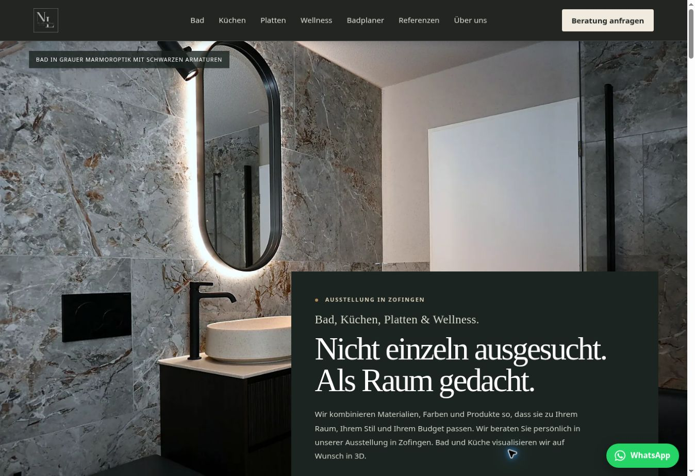
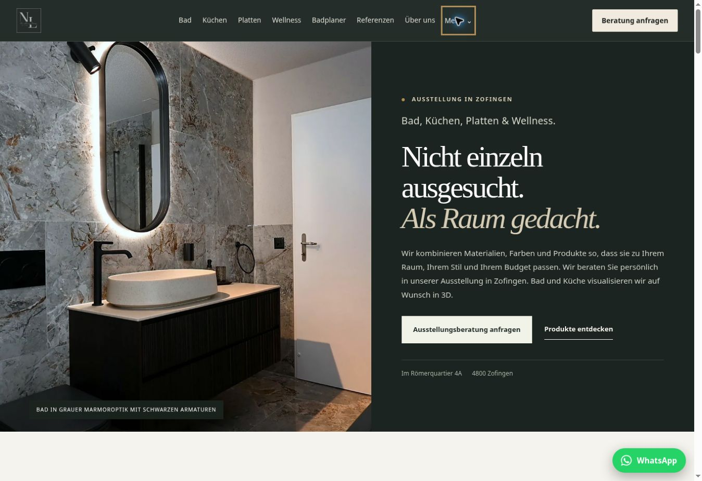
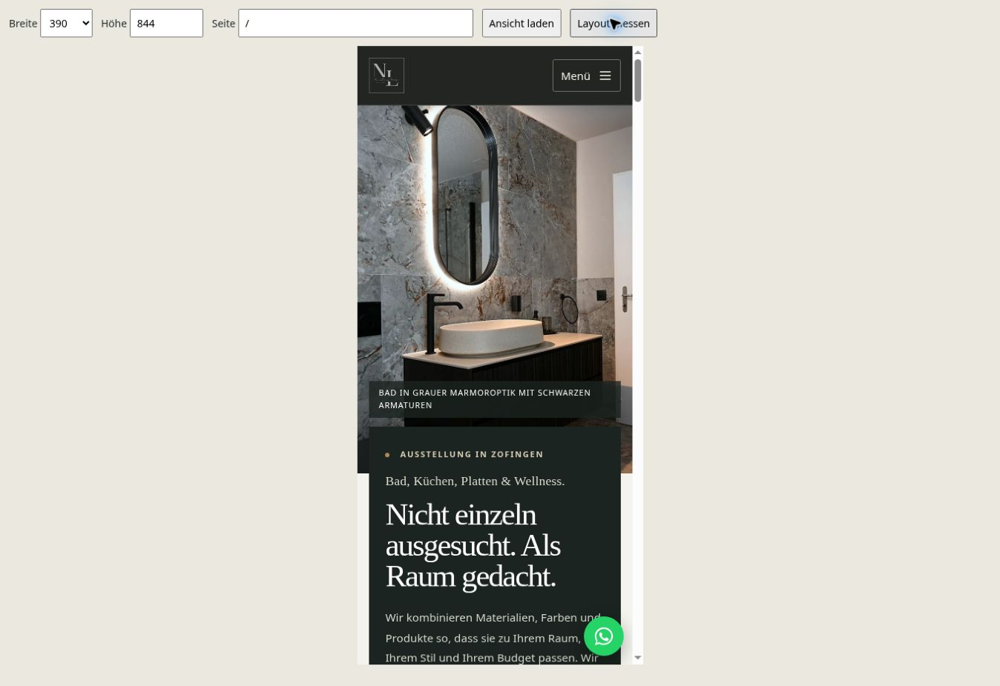
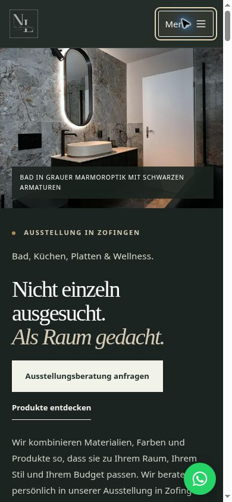
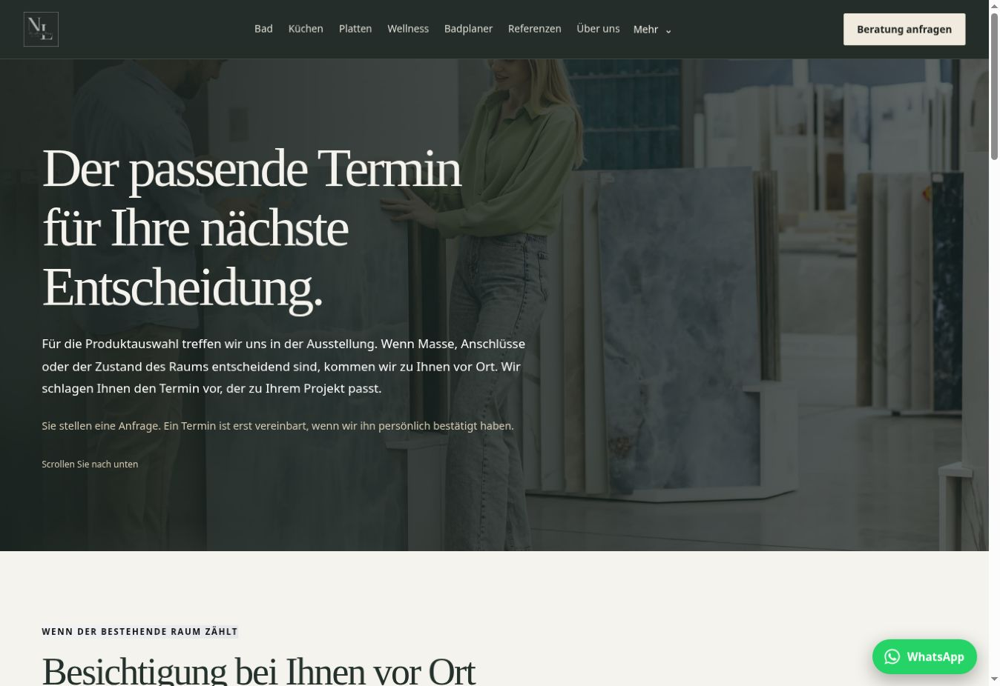
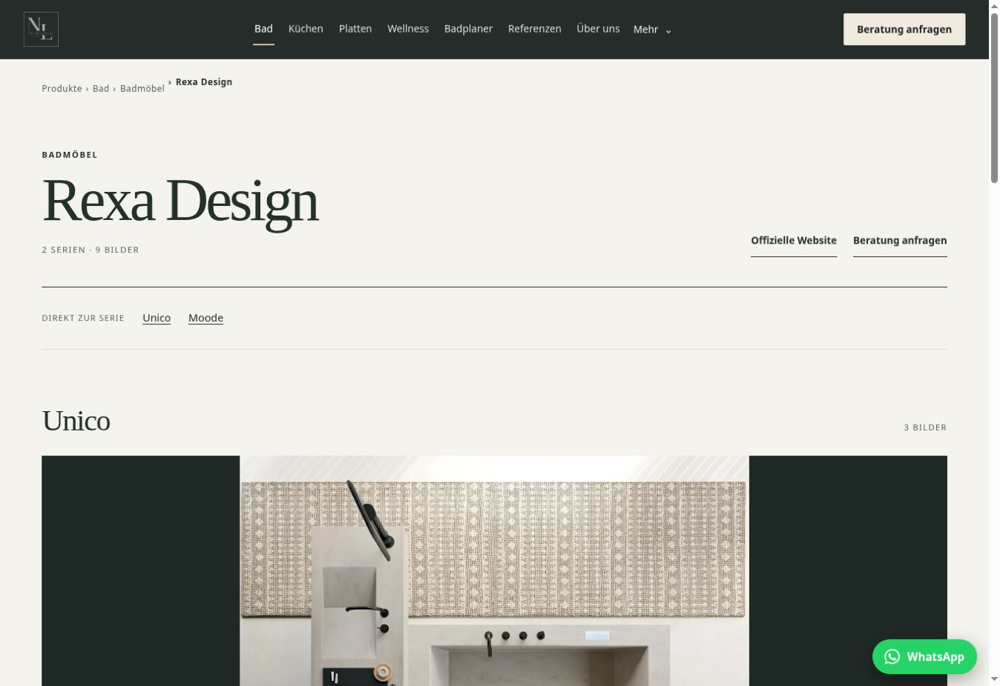
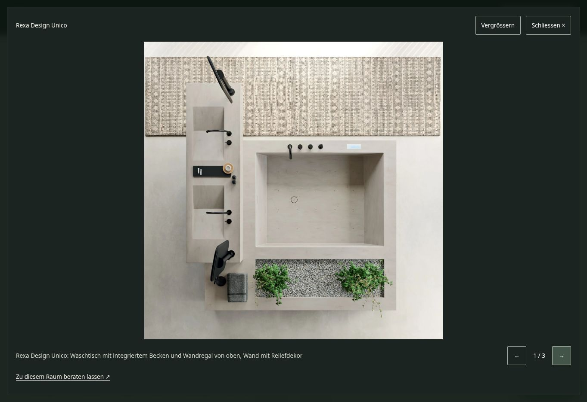
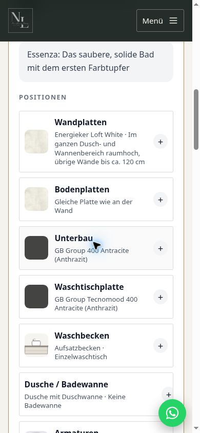
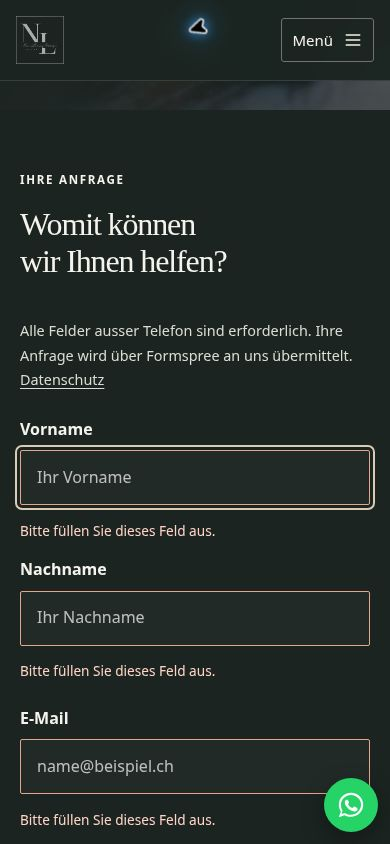

# New Living Design – Redesign 2026

Umsetzung vom 07.11.2026 auf `feat/premium-redesign-2026`, ausgehend von `5798dc701aea85c5e9cc3e95687f78406e82e441`. Die Änderungen sind zur Prüfung bestimmt. Es wurde weder nach `main` zusammengeführt noch produktiv veröffentlicht.

## Umfang und Ausgangslage

Die vollständige Liste der 55 Seiten und ihrer Vorlagen steht in [INVENTORY.md](INVENTORY.md). Sie umfasst sämtliche festen Seiten, vier Produktbereiche, 36 Markenseiten und den vorhandenen Blogartikel. Alle 55 öffentlichen URLs wurden zusätzlich per HTTP abgerufen: jeweils Status 200, siehe [public-route-check.json](public-route-check.json). Das ist eine Erreichbarkeitsprüfung, keine vollständige visuelle Prüfung jeder öffentlich ausgelieferten Seite.

Die Codeanalyse zeigte vor allem uneinheitliche Gestaltung, spät sichtbare Handlungsaufforderungen, fehlende Kontaktformular-Validierung, unzureichende Fokusführung in Galerien, eine mobile Showroom-Galerie mit festem Vier-Spalten-Raster und ein unnötig grosses Startbundle. Der Build konnte ausserdem trotz fehlgeschlagener HTML-Vorabgenerierung erfolgreich enden.

879 versionierte Dateien in den Bereichen Assets, öffentliche Dateien, APIs, Daten, Geschäftskonfiguration und Artikel sind gegenüber der Basis unverändert. Alle vorhandenen Bilder und Logos bleiben erhalten. Preise: Essenza CHF 23'000, Colore CHF 27'500, Atelier CHF 36'500; alle zugehörigen Einschränkungen und Leistungsbeschreibungen bleiben bestehen. Herstellerdaten und Referenztexte wurden nicht neu erfunden.

## Tatsächlich umgesetzt

| Bereich | Änderung und Wirkung |
|---|---|
| Designsystem | Gemeinsame Grün-, Stein-, Papier- und Messingtöne aus dem Bestand; semantische Farbtokens, kontraststarke Textvariante des Akzents, Systemschrift plus Serifentitel, fluide Abstände, klare Fokuszustände und grössere Bedienelemente. Keine neuen Webfonts. |
| Header / Footer | Vier direkte Bereichslinks, ergänzendes Desktop-Menü mit nativer `details`-Bedienung, vollständige mobile Navigation, Escape und Fokuswechsel. Beratung bleibt sichtbar; Footer-Kontaktlinks erhalten ausreichende Touch-Flächen und einen Link zu den Cookie-Einstellungen. |
| Startseite | Grosses bestehendes Referenzfoto mit ruhigem Typografie-Panel; Beratung im ersten Desktop-Bildschirm, auf Mobile vor dem längeren Erklärungstext. Unternehmenspositionierung, vier visuelle Kapitel mit aktivem Bereichsindex, Planungsprozess, echte Referenzen, Badplaner, Umbaupakete, Marken und Ausstellung sind miteinander verbunden. |
| Produkte / Kategorien | Bereichsindex, bessere Überschriftenhierarchie, ruhigere Bildflächen, gemeinsame Markenübersicht, Breadcrumbs und Beratungswege. Bestehende Kategorien und Inhalte bleiben erreichbar. |
| Alle Markenseiten | Gemeinsame Vorlage mit Serien-Sprungmarken, Herstellerlink, kontextbezogener Beratung und derselben neuen Galerie. Keine Marke und keine Serie entfernt. |
| Galerien / Referenzen | Native modale Lightbox, Bildzähler, Pfeiltasten, sichtbare Steuerung, Escape, Fokus-Rückgabe, Touch-Swipe und Zoom. Herstellerbilder werden vollständig und unverzerrt gezeigt. Referenzfilter sind als Auswahlgruppe mit `aria-pressed` beschriftet; Ergebniszahl wird angekündigt. |
| Dienstleistungen | Beratung, Planung und Umsetzung mit grosszügiger Bild-Text-Gestaltung und klarer Prozessfolge. Dekorative Schatten und Rundungen reduziert. |
| Badumbau | Bestehende Paketkarten neu gestaltet, aufklappbarer Leistungsvergleich aus den originalen Paketdaten, horizontal bedienbare Vergleichstabelle mit zugänglichen Paketkarten als mobile Alternative. Paket-CTA wählt das passende Anfragefeld voraus. Schutz gegen doppelte Übermittlung. |
| Badplaner | Drei sichtbare Schritte mit Status und Sperren, Tastaturwahl für Raum und Paket, Fokus beim Schrittwechsel, Reduced-Motion-konformes Scrollen, Upload-/Ladezustände und fokussierbares Ergebnis. API, Modell, Limits, Wiederholungen und Datenflüsse unverändert. |
| Über uns | Bestehende Unternehmensinformationen und Fotos mit konsistenter Typografie und ruhigerem Layout. Keine neuen Teammitglieder, Zahlen oder Zertifikate. |
| Kontakt | Verknüpfte Labels, Autocomplete, Pflichtfeld-/E-Mail-Prüfung, Inline-Fehler, Fokus auf das erste fehlerhafte Feld, Lade-/Erfolgs-/Fehlerzustände und sofortiger Doppelklick-Schutz. Eingaben bleiben bei Fehlern erhalten. Bestehender Formspree-Endpunkt bleibt gleich. |
| Showroom / Booking | Klarer Hinweis: Eine Anfrage reserviert noch keinen Termin. Responsive Galerie statt vier fest nebeneinander stehender Bilder; einheitliche Gestaltung und Kontaktwege. |
| Blog | Lesbare Textbreite, bessere Kontraste und Typografie, Inhaltsverzeichnis aus den vorhandenen Überschriften, eindeutige Anker bei wiederholten Überschriften und scrollbar zugängliche Tabellen. Artikelinhalt unverändert. |
| Rechtliches | Nur Darstellung der rechtlichen Seiten angepasst. Impressum, Datenschutz und AGB inhaltlich erhalten. Cookie-Einstellungen haben zugängliche Checkbox-Namen und beschreiben das tatsächlich vorhandene Opt-out-Verhalten für Statistik. |

## Neue und überarbeitete technische Komponenten

- `PageExperience`: gemeinsame, einmalige Scroll-Reveals mit `IntersectionObserver` und Web Animations API; Cleanup beim Seitenwechsel, Abbruch bei reduzierter Bewegung. Inhalte sind im Grundzustand sichtbar.
- `ImageLightbox`: gemeinsam für Referenzen und Herstellerbilder, mit nativem `dialog`, Fokusbegrenzung, Zoom, Swipe und Bildladefehler mit Wiederholung.
- `Gallery`, `Header`, `Footer`, `CookieSettings`, Seitenvorlagen und Markdown-Renderer verwenden die bestehenden Schnittstellen weiter.
- Unterseiten werden mit `React.lazy` und `Suspense` nach Bedarf geladen. Direkte Imports verhindern, dass Komponenten-Barrels schwere Unterseiten in das Startbundle ziehen.
- Asynchrones SSR wartet auf die Lazy-Komponenten. Das Prerendering liefert weiterhin vollständigen Inhalt ohne JavaScript und bindet nur die für die jeweilige Seite benötigten CSS-Chunks ein. Fehler machen den Build erfolglos. Erneutes Prerendering erzeugt keine doppelten Helmet-Metadaten.
- `check:redesign` überprüft den fertigen Build; die lokale Browser-Prüfseite ergänzt ihn um Layout-, axe- und Interaktionstests. Es wurde keine neue Produktionsabhängigkeit hinzugefügt. `axe-core` ist nur eine Entwicklungsabhängigkeit.

## Bewegung und responsive Darstellung

Die Homepage verwendet gestaffelte Textbewegung, dezenten Bildzoom, Image-Mask-Reveals und auf unterstützten Desktop-Browsern eine native Scroll-Timeline. Der aktive Bereichsindex und die Texte einzelner Kapitel bleiben beim Scrollen sichtbar. CSS-Transitions ergänzen Buttons und Referenzbilder. Kein Scroll-Hijacking, keine grossen Videos und kein neues Animationsframework.

Auf Mobile werden die Kapitel vertikal, komplexe Sticky-Kompositionen vereinfacht und die Hero-Höhe reduziert. `prefers-reduced-motion` stoppt CSS-Animationen und Transitions; die gemeinsame Animationskomponente berücksichtigt die Einstellung ebenfalls. Anker bleiben nach dem Laden einer Unterseite erreichbar.

Geprüft wurden 320, 375, 390, 430, 768, 1024, 1280, 1440 und 1920 CSS-Pixel sowie Querformat 844×390 und Reflow bei 640×450: **605 Layout-Fälle auf 55 Routen, keine horizontalen Seitenüberläufe**. Absichtlich horizontal scrollbar bleiben Bildgalerien und Vergleichstabellen. Diese Prüfung erfolgte in Chromium über gleichartige lokale Vorschau-Rahmen, nicht auf physischen Mobilgeräten.

## SEO

Alle bisherigen URLs bleiben bestehen. Jede der 55 Seiten besitzt nach dem Build genau eine H1, einen individuellen Titel, eine Beschreibung und einen passenden Canonical. Interne Links, Sprungziele, Bilddateien und Alt-Attribute wurden geprüft. Die vorhandenen Organization-, LocalBusiness-, Service- und Article-Daten bleiben erhalten; Katalogseiten erhalten BreadcrumbList-Daten. Unbekannte Katalogadressen zeigen die Fehlerseite statt einer irreführenden Weiterleitung.

Sitemap und robots.txt enthalten weiterhin alle vorgesehenen Seiten. `404.html` wird generiert und trägt `noindex`; die vorhandene Vercel-Routingkonfiguration wurde erhalten. Der tatsächliche HTTP-404-Status des künftigen Deployments ist nach Freigabe nochmals auf der Zielumgebung zu prüfen.

## Interaktionsprinzipien und Accessibility

Dies ist eine Umsetzung und technische Prüfung entlang der vorgegebenen Prinzipien, **keine ISO-Zertifizierung und kein vollständiger WCAG-Konformitätsnachweis**. Für eine Bewertung nach ISO 9241-210 und ISO 9241-115 fehlen insbesondere ein dokumentierter Beteiligungs-/Evaluationsprozess mit echten Zielgruppen und eine vollständige fachliche Prüfung.

| Prinzip aus ISO 9241-110 | Konkrete Umsetzung |
|---|---|
| Aufgabenangemessenheit | Direkte Bereichslinks, Seriennavigation, kontextbezogene Beratung und vorausgewähltes Badpaket. |
| Selbstbeschreibungsfähigkeit | Eindeutige Anfrage-Buttons, Schritte, Ergebniszähler, Upload-Hinweis und Formularstatus. |
| Erwartungskonformität | Konsistente Navigation, native Dialoge/Details, gleiche Galerie auf allen Markenseiten. |
| Erlernbarkeit | Sichtbare Dreischritt-Führung, klar gegliederte Kategorien und Formularbeschriftungen. |
| Steuerbarkeit | Freies Scrollen, Escape, Tastatur, Zoom und reduzierte Bewegung; keine erzwungene Scrollfolge. |
| Fehlerrobustheit | Pflichtfeldprüfung, Datenerhalt, Doppelklick-Schutz, Netzwerk-Fehlerstatus und fehlertolerantes Bildladen. |
| Benutzerbindung | Echte Projektbilder, konsistente Gestaltung und gezielte, zurückhaltende Bewegung. |

axe-core fand nach Korrekturen in den **55 geprüften Ausgangsansichten bei 390 Pixeln keine Verletzungen der aktivierten WCAG-A/AA-Regeln**. Die vollständigen Daten inklusive `incomplete` stehen in [responsive-axe.json](responsive-axe.json). Die letzte Kontrastkorrektur auf `/dienstleistungen` wurde separat nachgeprüft und mit Zeitangabe übernommen. Für die Kontrastprüfung wurden endliche Animationen zum Endzustand weitergeschaltet, weil Hintergrund-Tabs sie drosseln können. Das Ergebnis gilt nicht automatisch für jede Interaktionskombination.

Manuell geprüft: Desktop-Mehr-Menü und Escape, mobiles Menü, sichtbare Fokuszustände, Formularfehler und Fokus, Galerie-Bildwechsel und Escape, sowie Pfeiltastenwahl und Schrittfolge im Badplaner. Im kompilierten Produktions-Build wurden zusätzlich die clientseitige Navigation zur Kategorie Bad und der vollständige Paketvergleich geöffnet und geprüft. Ausstehend sind insbesondere vollständige Screenreader-Tests, echte Touch-/Pinch-Gesten, OS-Reduced-Motion, Browser-Zoom sowie Safari/Firefox und reale Mobilgeräte.

## Performance

Build-Artefakte wurden mit derselben lokalen Umgebung und gzip-Stufe 9 verglichen. Die Rohdaten liegen in [baseline-bundles.json](baseline-bundles.json) und [after-bundles.json](after-bundles.json).

| Initial geladene Ressourcen der Startseite | Vorher | Nachher | Veränderung |
|---|---:|---:|---:|
| JavaScript, unkomprimiert | 825'513 B | 355'253 B | −57.0 % |
| JavaScript, gzip | 210'488 B | 119'163 B | −43.4 % |
| CSS, unkomprimiert | 147'371 B | 45'420 B | −69.2 % |
| CSS, gzip | 24'958 B | 9'542 B | −61.8 % |

Der Badplaner bleibt ein separates Bundle und wird erst auf seiner Route benötigt. Das vorhandene Hero-Bild nutzt responsive Varianten und hohe Ladepriorität; weitere Bilder werden nach Bedarf geladen. Systemfonts verursachen keine zusätzliche Font-Anfrage. Die Prioritätsangabe wird als natives, kleingeschriebenes `fetchpriority` ausgegeben, da React 18 die spätere React-19-Prop-Schreibweise noch bemängelt.

**Nicht gemessen:** Lighthouse Mobile/Desktop sowie reale LCP-, INP- und CLS-Werte. Die vorhandene Browserumgebung bot keinen Lighthouse-Lauf mit kontrolliertem Netzwerk/CPU-Profil. Bundle-Grössen sind kein Ersatz für Core Web Vitals. Die Zielwerte LCP ≤2.5 s, INP ≤200 ms und CLS ≤0.1 müssen auf einem freigegebenen Deployment und anschliessend anhand ausreichender Felddaten geprüft werden.

## Tests

| Prüfung | Ergebnis |
|---|---|
| `npm run lint` | Bestanden |
| `npm test` | 229/229 bestehende Tests bestanden |
| `npm run typecheck:api` | Bestanden |
| `npm run check:catalog` | 36/36 Markenseiten bestanden |
| `npm run build` | Bestanden, 55/55 Routen plus 404 statisch generiert |
| `npm run check:redesign` | HTML, Canonicals, H1/IDs, JSON-LD, lokale Bilder, interne Links/Anker, Sitemap und 404 bestanden |
| Erneutes `npm run prerender` + `check:redesign` | Bestanden; Metadaten bleiben eindeutig |
| Lokale UI-Interaktionen | 17/17 bestanden, siehe [interactions.json](interactions.json) |
| Responsive Layout | 605/605 ohne horizontalen Seitenüberlauf |
| axe | Keine gemeldeten Regelverletzungen in den geprüften Ausgangsansichten nach Korrektur |
| Bestehende öffentliche URLs | 55/55 HTTP 200 |

Formular-Erfolg und HTTP-Fehler wurden mit lokal abgefangenen Antworten getestet; es wurde keine Test-E-Mail versendet. Eine reale Gemini-Generierung, Resend-Zustellung und das Produktiv-Formspree-Postfach wurden nicht ausgelöst. Dadurch wurden keine KI-Kontingente verbraucht. Der Badplaner wurde zusätzlich manuell bis zum Fotoschritt bedient; seine bestehenden API-/Daten-/Validierungstests bleiben grün.

Der fertige Produktions-Build wurde zusätzlich lokal geöffnet: vollständiges vorgerendertes HTML und seitenspezifische CSS-Dateien sind vorhanden. Die lokalen `/_vercel/insights`- und `/_vercel/speed-insights`-Skripte stehen ausserhalb von Vercel nicht zur Verfügung; dies ist keine Messung des produktiven Analytics-Betriebs.

Die npm-Meldung über die unbekannte Umgebungsoption `http-proxy` stammt aus der Testumgebung. Der bestehende Installationsstand meldet bereits veraltete transitive Pakete. Es wurde keine ungeprüfte Abhängigkeitsmigration vorgenommen.

## Offene fachliche Punkte

1. **Hosting:** Impressum nennt Hostpoint; Datenschutzerklärung und vorhandene Deployment-Konfiguration nennen Vercel. Den tatsächlichen Betrieb bestätigen und die rechtlichen Angaben abgestimmt korrigieren.
2. **Streitbeilegung:** Vorhandenen Link zur EU-Online-Streitbeilegungsplattform auf sachliche und rechtliche Aktualität prüfen. Keine eigenmächtige neue Rechtsaussage eingefügt.
3. **AGB:** Nummerierung springt von 13 auf 15. Nummerierung und Formulierungen mit dem Verantwortlichen prüfen.
4. **Badplaner:** Die Auswahl/Verkleinerung des Fotos ist lokal. Bei Erstellung gehen Foto und Auswahl an den bestehenden Server und Google Gemini. Der bestehende Ablauf versendet Foto/Ergebnis an NLD bereits vor einer späteren Kontaktangabe; Resend ist der primäre E-Mail-Dienst, Formspree der textbasierte Fallback. Der neue Upload-Hinweis beschreibt dieses Verhalten. Aufbewahrung, Einwilligung und Anbietervereinbarungen fachlich bestätigen.
5. **Tracking:** Statistik ist im bestehenden Code standardmässig aktiv, Marketing benötigt Zustimmung. Diese Logik wurde erhalten; Cookie-Einstellungen beschreiben sie jetzt korrekt. Rechtliche Bewertung des bestehenden Modells bleibt beim Verantwortlichen.
6. **Abnahme:** Visuelle Freigabe, reale Geräte-/Assistenztechniktests, Live-Integrationen und Lighthouse/Felddaten prüfen. Keine automatische Produktivfreigabe aus diesem Bericht ableiten.

## Screenshots

### Startseite – vorher / nachher

| Desktop vorher | Desktop nachher |
|---|---|
|  |  |

| Mobile vorher | Mobile nachher |
|---|---|
|  |  |

### Weitere geprüfte Ansichten

| Badplaner Mobile | Formularfehler Mobile |
|---|---|
|  |  |

Reproduktionsanleitung: [tests/redesign/README.md](../../tests/redesign/README.md).
